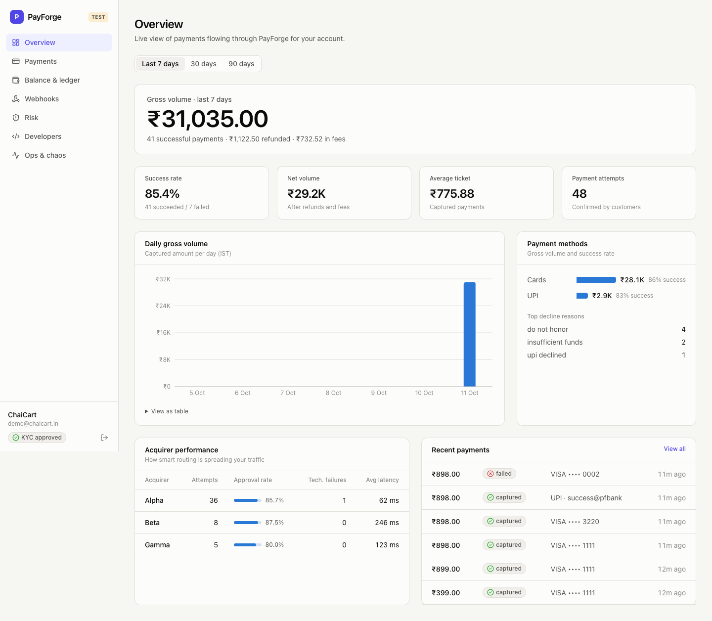
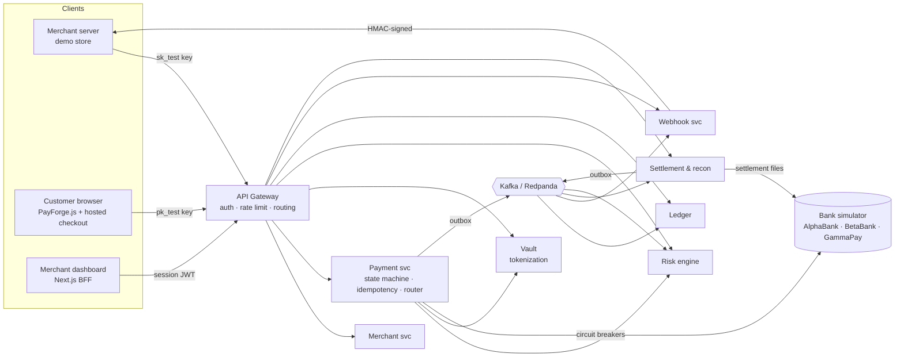
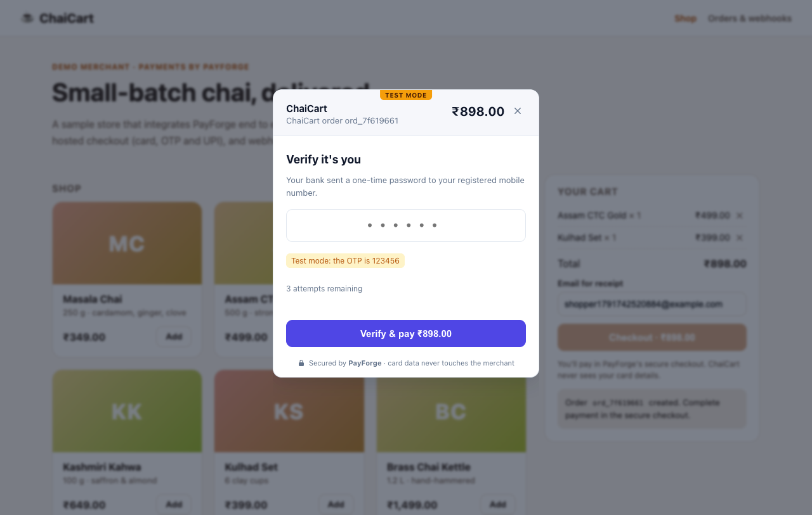
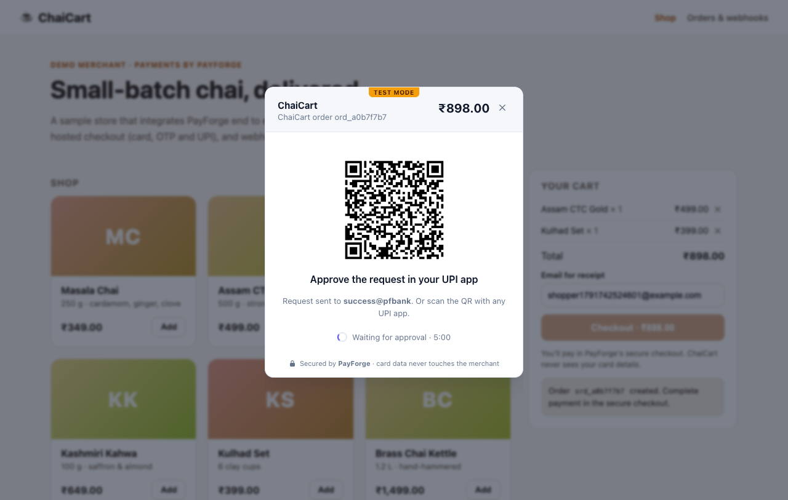
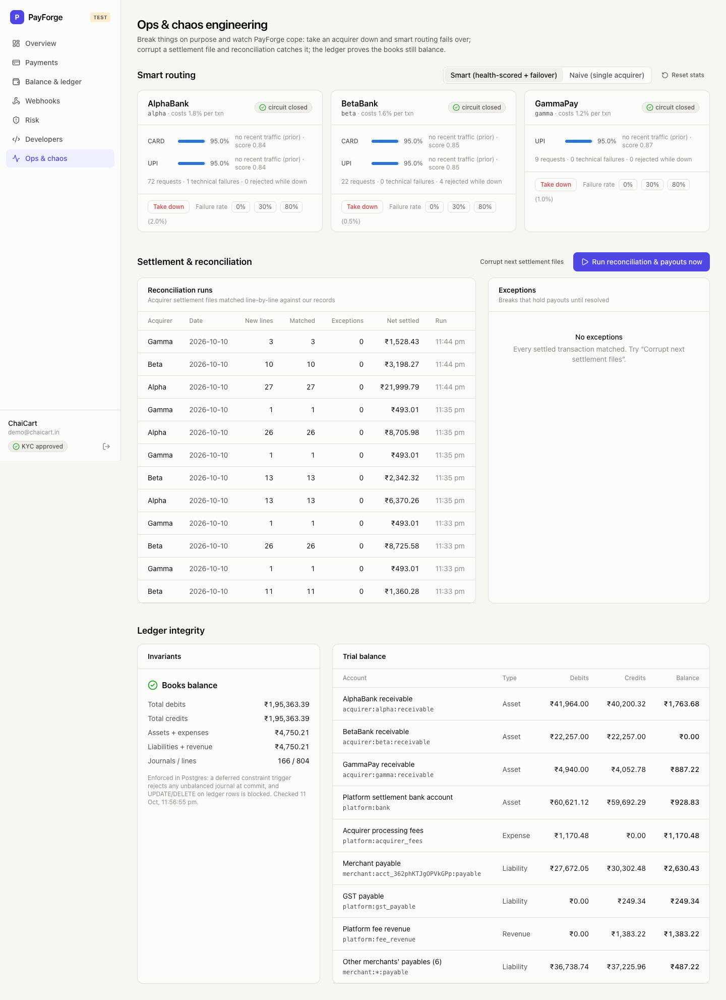

# PayForge

**A Stripe/Razorpay-style payment gateway built from scratch.** Nine NestJS microservices, Kafka, PostgreSQL and Redis, with a hosted checkout, a JavaScript SDK, a merchant dashboard and a simulated banking network to run it against.

PayForge is the infrastructure a merchant integrates with, not an app that calls Razorpay. It takes a payment from "customer clicks Pay" through risk scoring, card tokenization, smart routing across acquiring banks, OTP and UPI flows, an append-only double-entry ledger, signed webhooks, reconciliation against bank settlement files, and payouts to the merchant's bank account.

> Test mode only. All banks are simulated and no real money or real card data is involved. A real payment aggregator in India needs an RBI PA licence and PCI DSS certification; see [Scope](#scope--honest-limitations).



---

## Measured results

All numbers come from the scripts in this repo, run on one laptop (Apple Silicon, 16 GB) with all 9 services plus Postgres, Redis and Redpanda.

| What | Result | How to reproduce |
|---|---|---|
| Throughput | **137.7 payments/s** (413 API req/s), **100% success** over 4,175 payments | `npm run load` |
| Confirm latency | p50 **259 ms** · p95 **363 ms** · p99 **418 ms**, including the simulated bank's 60–220 ms | `npm run load` |
| Acquirer outage (AlphaBank down for 10 s) | Naive single-acquirer routing: **0.85%** success. PayForge smart routing: **99.55%** | `npm run load:chaos` |
| Idempotency storm | 50 concurrent identical requests create **exactly 1** payment | `npm run e2e` |
| Double-charge protection | 10 concurrent confirms on one payment produce **exactly 1** charge | `npm run e2e` |
| Over-refund protection | 20 concurrent ₹100 refunds on a ₹499 payment: **exactly 4** succeed | `npm run e2e` |
| k6 ramping load (to 120 arrivals/s) | **100%** of 4,599 payments · **0** failed of 13,801 requests · confirm p95 **319 ms** | `k6 run load-tests/k6/payment-flow.js` |
| k6 chaos (AlphaBank down 20 s of 60 s) | **99.83%** payment success · 0 failed HTTP requests of 20,077 | `k6 run load-tests/k6/chaos-failover.js` |
| Fault injection (payment DB starved: 1,468 pool timeouts) | Of **2,566** payments the bank approved, **0** lost or left stuck | [Case study](docs/case-study.md#fault-injection-starving-the-database) |
| Ledger integrity | Debits = credits, and assets + expenses = liabilities + revenue after every run (enforced in Postgres) | Dashboard → Ops |
| Test suite | **79 unit tests** (including property-based) · **30 end-to-end scenarios** · 4 real-browser checkout flows | `npm test`, `npm run e2e` |

---

## What makes it more than a CRUD project

| Problem real gateways face | How PayForge solves it | Where |
|---|---|---|
| A retried request must never charge twice | Idempotency keys stored with the response. The Postgres primary key is the lock, so no race window exists | [`idempotency.ts`](backend/libs/database/src/idempotency.ts) |
| Money must never be created or lost | Append-only **double-entry ledger**. A deferred constraint trigger rejects any unbalanced journal at commit | [`ledger migrations`](backend/apps/ledger/src/migrations.ts) |
| "Payment saved but the event was lost" (dual write) | **Transactional outbox**: state change and event commit together; a relay publishes to Kafka | [`outbox.ts`](backend/libs/messaging/src/outbox.ts) |
| A bank goes down during a sale | **Smart routing**: health-scored acquirers, circuit breakers, cascade on technical failure | [`router.service.ts`](backend/apps/payment/src/routing/router.service.ts) |
| A bank times out: did the money move? | Never retried elsewhere. The payment is parked as `pending` and a status-check worker resolves it | [`payments.service.ts`](backend/apps/payment/src/payments/payments.service.ts) |
| Fraud and card testing | Real-time **risk engine**: Redis sliding-window velocity, blocklists, anomaly rules, explainable scores | [`rules.ts`](backend/apps/risk/src/rules.ts) |
| Card data is radioactive (PCI DSS) | **Vault**: AES-256-GCM envelope encryption, AAD binding, HMAC fingerprints, audited decryption; CVC never stored | [`envelope.ts`](backend/apps/vault/src/envelope.ts) |
| The merchant's server is down | **Signed webhooks** with exponential backoff and jitter, dead-letter queue and replay | [`dispatcher.service.ts`](backend/apps/webhook/src/dispatcher.service.ts) |
| Our books vs the bank's books | **Reconciliation** of acquirer settlement files: amount mismatches, missing transactions, payout holds | [`recon.ts`](backend/apps/settlement/src/recon.ts) |
| Every payment has an illegal transition somewhere | An explicit **state machine** guards every status change, with optimistic version checks | [`state-machine.ts`](backend/apps/payment/src/domain/state-machine.ts) |

---

## Architecture



Each service owns its own Postgres database (database-per-service) and talks to the others over HTTP (synchronous, with timeouts) or Kafka (asynchronous, at-least-once, idempotent consumers). See **[docs/architecture.md](docs/architecture.md)** for sequence diagrams, the state machine and the ledger postings.

| Service | Port | Responsibility |
|---|---|---|
| `gateway` | 8080 | Public API. Authenticates API keys and dashboard JWTs, applies a token-bucket rate limit in Redis (Lua), strips spoofable headers, proxies |
| `merchant` | 4001 | Signup and login, API keys (SHA-256 hashed, instant revocation), mock KYC |
| `payment` | 4002 | PaymentIntents, confirm, OTP, capture, void, refunds, smart routing, background resolvers, analytics |
| `vault` | 4003 | The only service that sees card numbers: envelope encryption, Luhn/BIN/brand checks, audited reveal |
| `risk` | 4004 | Rule-based scoring (allow / OTP challenge / block), blocklists, decline-streak feedback loop |
| `ledger` | 4005 | Double-entry journals from events, balances, integrity proof |
| `webhook` | 4006 | Fan-out, signing, retries with backoff and jitter, DLQ, replay, SSRF guard |
| `settlement` | 4007 | Ingests acquirer settlement files, reconciles, pays merchants (T+1), raises exceptions |
| `bank-simulator` | 4009 | Three acquirers with different latency, cost and reliability, test cards, OTP, UPI collect, chaos controls |

## Tech stack

| Layer | Choice |
|---|---|
| Backend | Node.js 24 · **NestJS 11** (monorepo: 9 apps + 3 shared libs) · TypeScript (strict) |
| Data | **PostgreSQL 16** (raw SQL, migrations, row locks, advisory locks, constraint triggers) · **Redis 7** |
| Messaging | **Kafka API** via Redpanda · kafkajs (idempotent producer, consumer groups, dead-letter topic) |
| Resilience | opossum circuit breakers · timeouts everywhere · exponential backoff with jitter |
| Frontend | **Next.js 16** (App Router, BFF with httpOnly cookie) · React 19 · Tailwind CSS 4 · Recharts · SWR |
| Checkout & SDK | Vite + vanilla TypeScript (15 KB gz checkout) · **PayForge.js SDK is 1.6 KB gz** (ESM + UMD) |
| Observability | Prometheus metrics on every service · Grafana dashboard (provisioned) · OpenTelemetry tracing to Jaeger: one trace follows a payment across 8 services, **through Kafka** |
| Testing | Jest + **fast-check** property tests · end-to-end suite · k6 + Node load and chaos tests · headless-Chrome UI flows |
| Delivery | Docker (one backend image, `APP` selects the service) · Docker Compose profiles · GitHub Actions CI |

---

## Quickstart

**Prerequisites:** Node.js 20+ and Docker (Docker Desktop, Colima or OrbStack).

```bash
npm run setup        # installs every package, builds the SDK and backend
npm run infra:up     # Postgres (host port 55432), Redis, Redpanda/Kafka
npm run dev          # 9 services + checkout + dashboard (+ demo store once seeded)
npm run seed:data    # in a second terminal: demo merchant, 44 sample payments, store config
```

Restart `npm run dev` once after seeding so the demo store picks up its keys. Then open:

| | URL |
|---|---|
| Merchant dashboard | http://localhost:3001 (log in as `demo@chaicart.in` / `chaicart-demo-123`) |
| Demo store (ChaiCart) | http://localhost:3000 |
| API gateway | http://localhost:8080 |
| Swagger (per service) | http://localhost:4002/docs (payments) · :4001/docs · :4003/docs … |
| Grafana / Jaeger | `npm run infra:up:all`, then http://localhost:3002 · http://localhost:16686 |

**Or run everything in containers:**

```bash
npm run docker:up                                                   # builds 4 images, starts 18 containers
STORE_WEBHOOK_URL=http://demo-store:3000/webhooks/payforge npm run seed:data
docker compose -f infra/docker-compose.yml up -d --force-recreate --no-deps demo-store   # pick up the new keys
E2E_WEBHOOK_HOST=host.docker.internal npm run e2e                     # same 30 scenarios against the containers
```

Add tracing to either mode with `OTEL_ENABLED=true` and `npm run infra:up:all` (Jaeger on http://localhost:16686).

### Try it from the command line

```bash
SK=sk_test_...   # printed by `npm run seed`, or Dashboard → Developers
PK=pk_test_...

# 1. Merchant server creates a PaymentIntent (idempotent)
curl -s localhost:8080/v1/payment_intents -u $SK: -H 'Idempotency-Key: order-42' \
  -H 'content-type: application/json' -d '{"amount": 49900, "description": "Masala chai x2"}'

# 2. Browser tokenizes the card (publishable key: card data never reaches the merchant)
curl -s localhost:8080/v1/payment_methods -H "authorization: Bearer $PK" -H 'content-type: application/json' \
  -d '{"type":"card","card":{"number":"4111111111111111","exp_month":12,"exp_year":2030,"cvc":"123"}}'

# 3. Browser confirms: risk -> vault -> smart routing -> bank
curl -s localhost:8080/v1/payment_intents/pi_.../confirm -H "authorization: Bearer $PK" \
  -H 'content-type: application/json' -d '{"payment_method":"pm_...","client_secret":"pi_..._secret_..."}'
```

### Test cards and UPI IDs

| Number / UPI ID | Behaviour |
|---|---|
| `4111 1111 1111 1111` · `5555 5555 5555 4444` · `6522 0000 0000 0006` | Visa / Mastercard / RuPay: succeeds |
| `4000 0000 0000 3220` | OTP required (`123456`) |
| `4000 0000 0000 0002` · `4000 0000 0000 9995` | Declined · insufficient funds |
| `4000 0000 0000 0119` | Bank times out; resolved later by the status-check worker |
| `4000 0007 6000 0002` | International card (raises the risk score) |
| `success@pfbank` · `fail@pfbank` | UPI collect approved / declined after ~3 s |

---

## A 5-minute demo (for interviews)

1. **Pay.** In the store, buy chai with the OTP card. Show the hosted checkout (iframe), OTP step-up, and that the order is confirmed by the **signed webhook**, not the browser.
2. **Follow the money.** In Dashboard → Payments → the payment, show the timeline (events and acquirer attempts), the risk explanation, and the **six-line double-entry journal**: ₹499 → merchant ₹487.22, fee ₹9.98, GST ₹1.80, acquirer cost.
3. **Break a bank.** In Ops, take the preferred acquirer down, place orders, and show failover in the payment timeline and the circuit breaker opening (also in Grafana). Switch to "Naive" routing and show payments failing.
4. **Break the merchant.** On the store's Orders page, make its webhook endpoint fail for 60 s, place an order, and watch retries with backoff on the Webhooks page, then replay.
5. **Break the bank's file.** In Ops, click "Corrupt next settlement files", run reconciliation, and show the amount-mismatch exception and the payout held. The ledger still balances.

| Hosted checkout (OTP) | UPI collect (QR) | Ops & chaos |
|---|---|---|
|  |  |  |

---

## Testing

```bash
npm test             # 79 unit tests: money math, Luhn/BIN, envelope crypto, state machine,
                     # routing scores, risk rules, backoff, SSRF guard, ledger postings
                     # (property-based: every journal balances for ANY amount), reconciliation
npm run e2e          # 30 scenarios against the live stack, through the public API
npm run load         # throughput and latency of the full 3-call payment flow
npm run load:chaos   # AlphaBank outage: naive single-acquirer vs smart routing

# k6 (no install needed: runs from the official image)
docker run --rm --add-host=host.docker.internal:host-gateway -e API_URL=http://host.docker.internal:8080 \
  -v "$PWD/load-tests/k6:/scripts:ro" grafana/k6:0.54.0 run /scripts/payment-flow.js   # also idempotency-storm.js, chaos-failover.js
```

**Fault injection.** Run the payment service with a starved database pool (`DB_POOL_MAX=2 DB_CONNECT_TIMEOUT_MS=30`), drive load with `npm run load`, restore the pool, and compare the bank's approved transactions with PayForge's payments. Every bank-approved payment must end up captured, and nothing may stay stuck in `processing`. See the [case study](docs/case-study.md#fault-injection-starving-the-database) for the results.

CI (`.github/workflows/ci.yml`) typechecks, unit-tests and builds everything, then boots the full stack against real Postgres, Redis and Kafka and runs the e2e suite and a short load test.

## Repository layout

```
backend/                 NestJS monorepo
  apps/                  gateway · merchant · payment · vault · risk · ledger · webhook · settlement · bank-simulator
  libs/common            config, auth guard, errors, money, crypto, metrics, bootstrap, tracing
  libs/database          pg pool, transactions with retry, migrations, idempotency layer
  libs/messaging         Kafka wrapper, event contracts, transactional outbox
sdk/payforge-js          PayForge.js (iframe checkout SDK, ESM + UMD)
web/checkout             hosted checkout page (card, OTP, UPI QR)
web/dashboard            merchant dashboard (Next.js)
web/demo-store           ChaiCart: a reference merchant integration
infra/                   docker-compose, Prometheus, Grafana
scripts/                 setup, dev runner, seed, e2e, load/chaos tests
load-tests/k6            k6 scenarios
docs/                    architecture, case study, ADRs, interview guide, API reference
```

## Documentation

- **[Architecture](docs/architecture.md)**: diagrams, payment flow, state machine, events, ledger postings, failure matrix
- **[Case study: surviving a Diwali flash sale](docs/case-study.md)**: the problem, the decisions, the measured results
- **[Architecture decision records](docs/adr/)**: why Postgres, outbox, no-retry-on-timeout, envelope encryption and more
- **[API reference](docs/api.md)**
- **[Interview guide](docs/interview-guide.md)**: how to explain this project, with likely questions and answers

## Security notes

- Secret API keys are stored only as SHA-256 hashes; rolling a key evicts the gateway cache so the old key dies instantly.
- Services reject any request without the internal token; the gateway strips client-supplied `x-merchant-id` / `x-internal-token` headers.
- Card numbers are stored only encrypted (per-record key, AES-256-GCM, record id as AAD); CVC is never stored; every decryption is audited.
- Browsers use publishable keys plus the payment's client secret; a wrong secret gets a 404 (no existence oracle).
- Webhooks are HMAC-SHA256-signed with a timestamp (replay window of 5 min); webhook URLs are checked against private and link-local ranges (SSRF).
- Dashboard sessions live in an httpOnly, SameSite=Lax cookie behind a BFF proxy; the JWT is never readable by page JavaScript.
- Services refuse to boot in production with development secrets.

## Scope & honest limitations

- **Simulated network.** The three acquirers, OTP and UPI are simulated. A real integration would replace the bank-simulator adapter (for example ISO 8583 or a bank's REST API) behind the same interface.
- **Test mode only.** No live keys. Real operation needs an RBI Payment Aggregator licence, PCI DSS Level 1 certification, an HSM or KMS for the vault keys, and mTLS between services instead of a shared internal token.
- **Single region, single Postgres instance per service.** Hot ledger accounts would need sharded balances at very high volume (see the ADRs).
- **Single-machine benchmarks.** Load numbers come from a laptop running everything at once; they show behaviour under load, not production capacity.

## License

MIT
