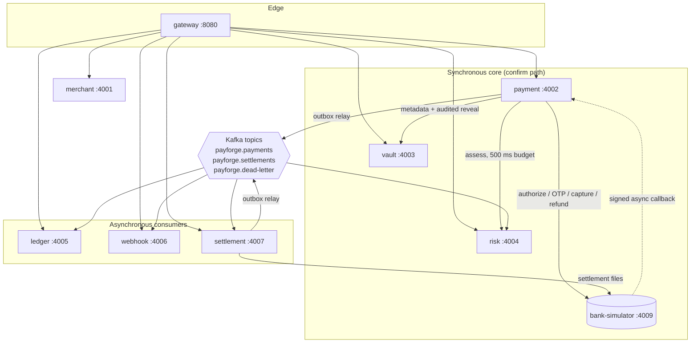
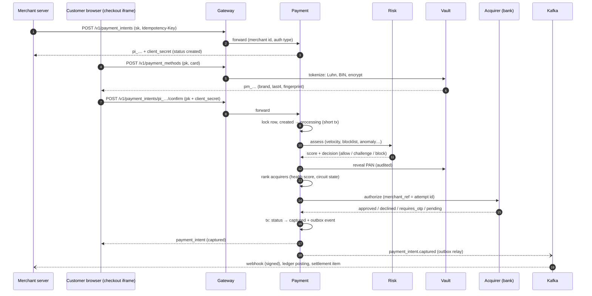
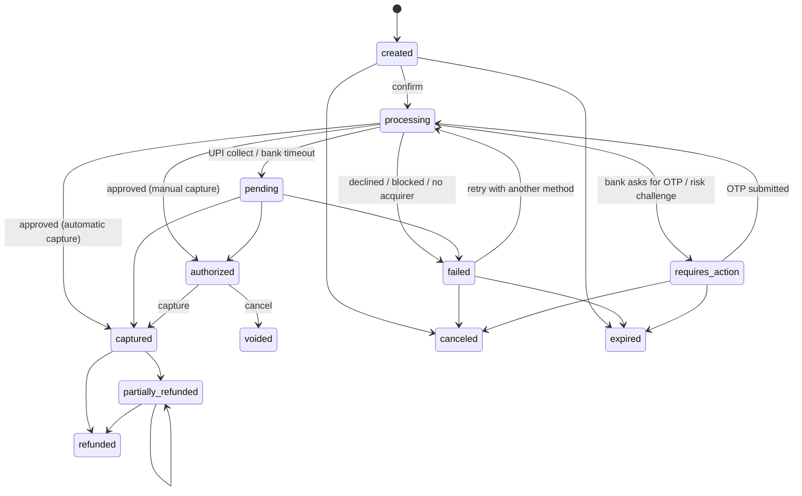
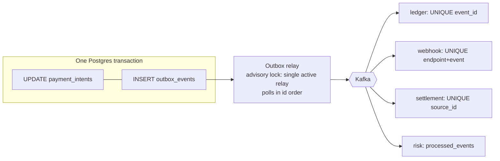

# Architecture

## 1. System overview

PayForge is nine services behind one API gateway. Synchronous calls (HTTP with strict timeouts) are used only where the caller needs an answer *now*: the confirm path. Everything else (ledger postings, webhooks, settlement, risk feedback) flows asynchronously through Kafka, so a slow or broken consumer can never slow down or fail a payment.



### Data ownership (database-per-service)

| Service | Database | Owns |
|---|---|---|
| merchant | `pf_merchant` | merchants, api_keys (hashed) |
| payment | `pf_payment` | payment_intents, payment_attempts, refunds, idempotency_keys, outbox_events |
| vault | `pf_vault` | payment_methods (encrypted PAN + wrapped DEK), vault_access_log |
| risk | `pf_risk` | risk_assessments, blocklist, processed_events (+ Redis velocity windows) |
| ledger | `pf_ledger` | accounts, journal_entries, ledger_lines (append-only) |
| webhook | `pf_webhook` | webhook_endpoints, webhook_deliveries, webhook_attempts |
| settlement | `pf_settlement` | settlement_items, acquirer_report_lines, recon_runs, recon_exceptions, payouts, outbox_events |
| bank-simulator | `pf_bank` | bank_transactions (the "bank's" side) |

No service reads another service's tables. Cross-service data travels in events (with an `internal` section for platform-only fields such as acquirer cost) or through internal HTTP endpoints.

---

## 2. The payment flow



Design rules visible in the flow:

- **No DB lock is held across a network call.** The confirm path claims the payment in a short transaction (`created → processing`), calls risk, vault and the bank with no locks held, then applies the outcome in a second short transaction.
- **Write-ahead attempts.** A `payment_attempts` row (`initiated`) is written *before* calling the bank, so even if the process dies mid-call we know which bank to ask afterwards.
- **The bank de-duplicates on our attempt id** (`merchant_ref`), so retried authorizations or captures can never create a second charge.

---

## 3. Payment state machine



Every transition goes through `PaymentRepository.transition()`, which checks the move against this table, applies it with an optimistic `version` check, and writes the domain event to the outbox in the same transaction. The same function serves the API, bank callbacks, the status poller and the expiry job, so there is exactly one place where payment state can change.

---

## 4. Smart routing & resilience

```
rank(method):
  candidates = acquirers supporting the method
  drop candidates whose circuit is OPEN
  score = 0.60 × success rate   (last 5 min, smoothed toward a 95% prior)
        + 0.25 × speed          (latency of successful calls only)
        + 0.15 × cheapness      (acquirer cost in bps)
  with probability ε = 5%, try a non-preferred acquirer first (keeps stats fresh)
```

| Acquirer outcome | What PayForge does | Why |
|---|---|---|
| approved / declined / OTP / pending | Apply it. Counts as *healthy* for routing | A decline is the issuer's decision, not acquirer failure |
| 5xx, connection refused, circuit open | Mark attempt `technical_failure`, **cascade to the next acquirer** | Nothing was processed, so retrying elsewhere is safe |
| **timeout** | Mark attempt `unknown`, payment → `pending`, **never cascade** | The money may have moved; a second acquirer could double-charge |

Circuit breakers (opossum, one per acquirer) open when at least 50% of at least 5 requests in a rolling 10 s window fail, then send one trial request after 10 s (half-open).

Background workers in the payment service make the system self-healing:

| Worker | Every | Does |
|---|---|---|
| status check | 2 s | Asks the bank about `initiated` (crashed mid-call), `pending` (UPI) and `unknown` (timeout) attempts; backoff 2 s → 60 s; marks `not_found` after 60 s |
| expiry | 15 s | Expires abandoned payments (30 min TTL) |
| refund retry | 5 s | Re-sends refunds that hit an acquirer outage (idempotent on the refund id) |
| stuck-payment sweeper | 30 s | Fails payments left in `processing` with no open bank attempt (the process died before calling any bank; no money moved) |
| idempotency purge | 1 h | Deletes keys older than 24 h |

UPI collect results also arrive as **HMAC-signed bank callbacks**. Callback and poller race safely, because outcome application locks the payment then the attempt and ignores already-resolved attempts.

---

## 5. Events (transactional outbox)



Each outbox row also stores the W3C trace context of the request that produced it, and the relay publishes inside that context. One trace in Jaeger therefore runs from the gateway through payment, risk, vault and the bank, then across Kafka into the ledger, webhook, settlement and risk consumers (8 services).

Delivery is **at-least-once**: a crash between publishing and marking rows published republishes them. Every consumer is idempotent through a unique constraint, which gives exactly-once *effects*. If Kafka is down, payments keep succeeding and events accumulate in the outbox (the "Outbox backlog" panel in Grafana) until Kafka returns.

| Event | Producer | Consumers |
|---|---|---|
| `payment_intent.created / requires_action / pending / authorized / canceled / voided / expired` | payment | webhook |
| `payment_intent.captured` | payment | ledger, settlement, risk (merchant average), webhook |
| `payment_intent.payment_failed` | payment | risk (issuer declines only), webhook |
| `refund.created / refund.succeeded / refund.failed` | payment | ledger, settlement, webhook |
| `acquirer_settlement.received` *(internal)* | settlement | ledger |
| `payout.paid` | settlement | ledger, webhook |

---

## 6. Ledger postings

Normal balances: assets and expenses grow with debits; liabilities and revenue grow with credits.

**Capture of ₹499.00 via AlphaBank (2% fee, 18% GST, 1.8% acquirer cost)**

| Account | Type | Debit | Credit |
|---|---|---:|---:|
| `acquirer:alpha:receivable` | asset | 499.00 | |
| `merchant:{id}:payable` | liability | | 487.22 |
| `platform:fee_revenue` | revenue | | 9.98 |
| `platform:gst_payable` | liability | | 1.80 |
| `platform:acquirer_fees` | expense | 8.98 | |
| `acquirer:alpha:receivable` | asset | | 8.98 |
| **Total** | | **507.98** | **507.98** |

| Event | Debit | Credit |
|---|---|---|
| `refund.succeeded` (R) | merchant payable R | acquirer receivable R |
| `acquirer_settlement.received` (net N) | platform bank N | acquirer receivable N |
| `payout.paid` (P) | merchant payable P | platform bank P |

Invariants enforced by Postgres, not just by application code:

1. `ledger_lines.amount > 0` and every line references a journal and an account.
2. A **deferred constraint trigger** sums each journal at COMMIT and raises if debits ≠ credits.
3. `BEFORE UPDATE OR DELETE` triggers make journals and lines **append-only**. Mistakes are corrected with reversing entries.
4. `journal_entries.event_id` is UNIQUE, so the same event can never be posted twice.

All money is integer **paise** (`bigint`), with half-up rounding done in integer arithmetic.

---

## 7. Settlement & reconciliation

1. Every captured payment and succeeded refund becomes a `settlement_item` (our side).
2. Nightly at 02:00 IST (or on demand in demo mode), each acquirer's settlement file is fetched and every line is ingested exactly once (`acquirer_ref` primary key).
3. Lines and items are joined on `merchant_ref`, the attempt or refund id we sent with every request:
   - **matched**: same amount → eligible for payout
   - **amount_mismatch**: payout held, exception raised
   - **missing_in_acquirer**: we captured it but the bank didn't report it (after a grace period)
   - **missing_in_platform**: the bank settled something we have no successful record of (for example a late approval after we gave up)
4. The net settlement (sales − refunds − fees) is posted to the ledger as cash received.
5. Payouts sum matched, unpaid items per merchant, only if KYC is approved, and generate a UTR.

---

## 8. Failure matrix

| Failure | Effect on customers | How it's handled |
|---|---|---|
| Preferred acquirer down | None | Cascade to the next acquirer; circuit opens; routing demotes it |
| All acquirers down | Payment fails fast with `acquirers_unavailable` | Customer can retry the same intent; status unchanged otherwise |
| Acquirer timeout | Payment shows "confirming with your bank" | `pending` + status-check worker; never re-sent elsewhere |
| Risk service slow or down | Customer gets an OTP step-up | **Fail safe**: decision falls back to `challenge` after 500 ms |
| Vault down | Payment fails with `processing_error` | Nothing sent to any bank; customer can retry |
| Kafka down | None | Outbox buffers events; relay resumes with backoff |
| Ledger / webhook consumer down | None | Kafka retains events; consumer catches up from its offset |
| Poison event | None | 5 retries with backoff, then `payforge.dead-letter` |
| Merchant webhook endpoint down | None | 8 attempts over ~10 min (equal jitter), then dead-lettered; one-click replay |
| Redis down | None | Rate limiter fails open; routing falls back to priors |
| Payment service crashes mid-authorization | Payment shows pending | The write-ahead attempt row lets the poller ask the bank and finish it |
| Our DB fails *after* the bank answered | Payment shows "processing" briefly | Never failed: the attempt stays open and the status checker re-applies the bank's answer (fault-injected: 0 of 2,566 approvals lost) |
| Process dies before calling any bank | Payment fails after ~2 min | Stuck-payment sweeper; no money moved |
| Duplicate request / double click | None | Idempotency key replay; row lock + state machine reject double confirms |
| Settlement file wrong | None (merchant payout held) | Recon exception; ledger shows the receivable difference |

---

## 9. Security model

| Boundary | Control |
|---|---|
| Internet → gateway | API keys (secret = server, publishable = browser) or dashboard JWT; token-bucket rate limits per merchant / IP |
| Gateway → services | Shared internal token (constant-time compare); client copies of internal headers are stripped; services are deny-by-default (`@Auth(...)` opt-in per endpoint) |
| Browser → payment | Publishable key + client secret per intent; unknown or mismatched → 404 |
| Card data | Lives only in the vault: AES-256-GCM, per-record DEK wrapped by a versioned KEK, record id as AAD, HMAC fingerprints, audited reveal, no CVC storage |
| Bank → payment callbacks | HMAC-SHA256 over the raw body |
| Platform → merchant webhooks | HMAC-SHA256 with timestamp, SSRF guard on registration and send |
| Dashboard | BFF proxy, httpOnly + SameSite=Lax session cookie (CSRF-resistant), bcrypt passwords, constant-time login (no user enumeration) |

## 10. Observability

- `GET /metrics` on every service (Prometheus): HTTP latency histograms by route pattern, payment outcomes, acquirer outcomes and latency, circuit-breaker state, failovers, outbox backlog, risk decisions, journals posted, webhook outcomes, consumer throughput.
- Grafana dashboard `infra/grafana/dashboards/payforge.json` is provisioned automatically (`npm run infra:up:all` → http://localhost:3002).
- OpenTelemetry auto-instrumentation (HTTP, Express, pg, ioredis, kafkajs) exports to Jaeger when `OTEL_ENABLED=true`, so one trace follows a payment across services and through Kafka.
- Every response carries a `request-id`, propagated through every downstream call and included in error bodies.
